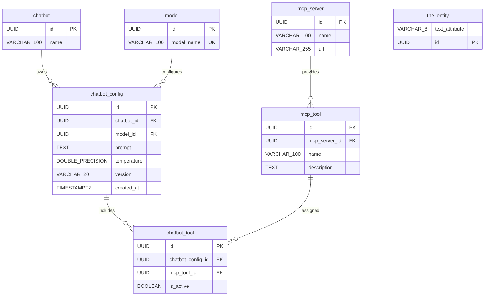

# Data Model: As-Built Database Schema of muchabo

**As of**: 2026-11-27 (source state identical to `main` since PR #29; first documented 2026-11-17)

**Feature**: `specs/001-specify-core-domain`

**References**: [spec.md](spec.md), [plan.md](plan.md)

## 1. Evidence Base and Scope

This document describes the application schema reconstructable from the existing migrations V001–V003 and the Java entities. Whether these migrations were applied to a concrete database and whether manual deviations exist there was not investigated by a live query.

Project-relative base paths for the following source references:

- **J**: `admin-backend/src/main/java/de/muenchen/oss/refarch/backend/`.
- **M**: `admin-backend/src/main/resources/db/migration/`.

The schema source is M `schema/V001__TheEntity_schema.sql`, `schema/V002__Project_Init.sql`, and `schema/V003__Add_MCP.sql`. Entity mapping and Bean Validation supplement these database rules. M `testdata/R__Testdata.sql` modifies example data only.

**Inventory**: 7 application tables, 24 stored columns, 7 primary keys, 2 additional unique constraints, and 5 foreign keys. Only `mcp_tool.description` is nullable; the remaining 23 columns are non-null explicitly or by virtue of the primary key. Six tables form the core domain; `the_entity` is an isolated example as-built state.

Table names are used in SQL without a schema prefix. The actual PostgreSQL schema depends on the execution environment and its `search_path`. A Flyway-managed schema history table is not a domain-level object defined by these migrations and does not count among the seven application tables.

## 2. Shared Identity and Notation

J `common/BaseEntity.java:17–31` is a `@MappedSuperclass` with `UUID id`, `@Id`, and `@GeneratedValue(strategy = GenerationType.UUID)`. All seven entities inherit this identifier; a separate table for `BaseEntity` does not exist. The mapping attribute `length = 36` does not change the SQL type `UUID` into a text column. `serialVersionUID` is not a stored domain attribute.

All tables have `id UUID` as primary key. The six core tables additionally have the SQL default `gen_random_uuid()`; `the_entity.id` has no SQL default. Regular creation via the Java object model therefore also generates example identifiers; direct SQL creation there requires a provided identifier.

"None" in a Default column means that the migration does not prescribe an SQL default. Defaults apply when the column is omitted or the default is used, not when `NULL` is explicit. For nullable columns without a default, omission can result in `NULL`; for mandatory columns, the required value must be provided.

## 3. Tables and Columns

### 3.1 `chatbot` — Named Chatbot

**Sources**: J `chatbot/Chatbot.java:18–23`; M `schema/V002__Project_Init.sql:6–9`.

| Column | SQL Type | NULL allowed | SQL Default | Database Rule | Java Attribute / Type |
| --- | --- | --- | --- | --- | --- |
| `id` | `UUID` | No | `gen_random_uuid()` | Primary key | `id: UUID`, inherited |
| `name` | `VARCHAR(100)` | No | None | At most 100 characters, not unique | `name: String` |

Chatbots with the same name, empty names, and whitespace-only names are not excluded by these rules. A chatbot can exist without a configuration.

### 3.2 `model` — Reusable Model

**Sources**: J `model/Model.java:18–23`; M `schema/V002__Project_Init.sql:1–4`.

| Column | SQL Type | NULL allowed | SQL Default | Database Rule | Java Attribute / Type |
| --- | --- | --- | --- | --- | --- |
| `id` | `UUID` | No | `gen_random_uuid()` | Primary key | `id: UUID`, inherited |
| `model_name` | `VARCHAR(100)` | No | None | `UNIQUE`, at most 100 characters | `modelName: String` |

There is no minimum text length and no domain-level name normalization. An empty model name is possible, but not a second identical empty name. The concrete comparison behavior of a database instance additionally depends on its collation, which is not explicitly defined here.

### 3.3 `chatbot_config` — Chatbot Configuration

**Sources**: J `chatbot/ChatbotConfig.java:29–61`; M `schema/V002__Project_Init.sql:11–23`.

| Column | SQL Type | NULL allowed | SQL Default | Database Rule | Java Attribute / Type |
| --- | --- | --- | --- | --- | --- |
| `id` | `UUID` | No | `gen_random_uuid()` | Primary key | `id: UUID`, inherited |
| `chatbot_id` | `UUID` | No | None | FK to `chatbot.id` | `chatbot: Chatbot` |
| `model_id` | `UUID` | No | None | FK to `model.id` | `model: Model` |
| `prompt` | `TEXT` | No | None | No additional length/content check | `prompt: String` |
| `temperature` | `DOUBLE PRECISION` | No | None | No range `CHECK` | `temperature: Double` |
| `version` | `VARCHAR(20)` | No | None | At most 20 characters, not unique | `version: String` |
| `created_at` | `TIMESTAMP WITH TIME ZONE` | No | `CURRENT_TIMESTAMP` | No SQL immutability rule | `createdAt: OffsetDateTime` |

Chatbot and model are each `@ManyToOne(fetch = LAZY, optional = false)` with a non-null join column. In addition, the Java object contains `List<ChatbotTool> chatbotTools`: an inverse `@OneToMany(mappedBy = "chatbotConfig", cascade = ALL, orphanRemoval = true)` relationship, initially empty. This collection is not an additional stored column; a stored order is not defined.

`createdAt` uses `@CreationTimestamp` and `updatable = false`. Hibernate generates the timestamp at creation and does not include it in regular update assignments. SQL has its own insert default, but no trigger or constraint for immutability. PostgreSQL stores a point in time, not the original time zone name or offset as additional information. `CURRENT_TIMESTAMP` refers to the start of the current transaction, not necessarily to a new timestamp per row.

The version label is not a `@Version` locking attribute. Neither format, automatic ordering, release/current status, nor uniqueness per chatbot is defined. For prompt and temperature, no general immutability rule exists.

### 3.4 `mcp_server` — Tool Provider

**Sources**: J `mcp/McpServer.java:18–26`; M `schema/V003__Add_MCP.sql:1–5`.

| Column | SQL Type | NULL allowed | SQL Default | Database Rule | Java Attribute / Type |
| --- | --- | --- | --- | --- | --- |
| `id` | `UUID` | No | `gen_random_uuid()` | Primary key | `id: UUID`, inherited |
| `name` | `VARCHAR(100)` | No | None | At most 100 characters, not unique | `name: String` |
| `url` | `VARCHAR(255)` | No | None | At most 255 characters, not unique | `url: String` |

There is no address format or reachability check. Present but empty texts are permitted at the schema level. A server can exist without tools.

### 3.5 `mcp_tool` — Tool of a Server

**Sources**: J `mcp/McpTool.java:21–35`; M `schema/V003__Add_MCP.sql:7–14`.

| Column | SQL Type | NULL allowed | SQL Default | Database Rule | Java Attribute / Type |
| --- | --- | --- | --- | --- | --- |
| `id` | `UUID` | No | `gen_random_uuid()` | Primary key | `id: UUID`, inherited |
| `mcp_server_id` | `UUID` | No | None | FK to `mcp_server.id`, delete cascade | `mcpServer: McpServer` |
| `name` | `VARCHAR(100)` | No | None | At most 100 characters, not unique | `name: String` |
| `description` | `TEXT` | Yes | None | Optional description | `description: String` |

The server reference is `@ManyToOne(fetch = LAZY, optional = false)` with a non-null join column. Tool names are not unique even within the same server. A missing and an empty description are both permitted, but different values. A tool can exist without a configuration assignment.

### 3.6 `chatbot_tool` — Configuration-Related Tool Assignment

**Sources**: J `mcp/ChatbotTool.java:18–42`; M `schema/V003__Add_MCP.sql:16–25`.

| Column | SQL Type | NULL allowed | SQL Default | Database Rule | Java Attribute / Type |
| --- | --- | --- | --- | --- | --- |
| `id` | `UUID` | No | `gen_random_uuid()` | Primary key | `id: UUID`, inherited |
| `chatbot_config_id` | `UUID` | No | None | FK to `chatbot_config.id`, delete cascade; part of the unique pair | `chatbotConfig: ChatbotConfig` |
| `mcp_tool_id` | `UUID` | No | None | FK to `mcp_tool.id`, delete cascade; part of the unique pair | `mcpTool: McpTool` |
| `is_active` | `BOOLEAN` | No | `TRUE` | Active flag, not part of the unique pair | `isActive: boolean`, initially `true` |

Both object references are `@ManyToOne(fetch = LAZY, optional = false)` with non-null join columns. The entity names its table explicitly with `@Table` and defines the same unique constraint as the migration: `uq_chatbot_config_tool(chatbot_config_id, mcp_tool_id)`.

The assignment has its own identifier; the pair is an additional unique key, not its primary key. A different active flag does not allow a second record of the same pair.

### 3.7 `the_entity` — Isolated Example Entity

**Sources**: J `theentity/TheEntity.java:24–33`; M `schema/V001__TheEntity_schema.sql:1–5`.

| Column | SQL Type | NULL allowed | SQL Default | Database Rule | Java Attribute / Type |
| --- | --- | --- | --- | --- | --- |
| `text_attribute` | `VARCHAR(8)` | No | None | At most 8 characters, no SQL minimum length | `textAttribute: String` |
| `id` | `UUID` | No | None | Primary key | `id: UUID`, inherited |

The column order corresponds to V001. The entity and the request DTO additionally use `@NotNull` and `@Size(min = 2, max = 8)`; the controller validates input on creation and modification with `@Valid`. SQL alone, by contrast, also permits an empty text or a text shorter than two characters. Whitespace-only texts are not excluded within the respective length limits.

There are no relationships to the core domain. The SQL generation of an identifier by default is missing here; the inherited Java mapping generates identifiers on regular creation.

## 4. Keys, Relationships, and ER Diagram

### 4.1 Primary and Additional Uniqueness Keys

| Table | Primary Key | Additional Unique Constraint |
| --- | --- | --- |
| `chatbot` | `id` | None |
| `model` | `id` | `UNIQUE(model_name)`; no explicit constraint name prescribed |
| `chatbot_config` | `id` | None, in particular not `(chatbot_id, version)` |
| `mcp_server` | `id` | None |
| `mcp_tool` | `id` | None, in particular not `(mcp_server_id, name)` |
| `chatbot_tool` | `id` | `uq_chatbot_config_tool(chatbot_config_id, mcp_tool_id)` |
| `the_entity` | `id` | None |

The migrations do not prescribe their own names for the primary keys. Automatically assigned constraint names are not a finding verified against an instance here.

### 4.2 Foreign Keys and Cardinalities

All five references are mandatory. Per dependent row, exactly one existing target is referenced; each target can have 0..n dependent rows. SQL defines no explicit update action or deferrability. The PostgreSQL default is `ON UPDATE NO ACTION` and `NOT DEFERRABLE`.

| Constraint | Dependent Column | Target | Target → Dependent Objects | ON DELETE | ON UPDATE |
| --- | --- | --- | --- | --- | --- |
| `fk_chatbot_config_chatbot` | `chatbot_config.chatbot_id` | `chatbot.id` | 1 → 0..n configurations | `NO ACTION` (default) | `NO ACTION` (default) |
| `fk_chatbot_config_model` | `chatbot_config.model_id` | `model.id` | 1 → 0..n configurations | `NO ACTION` (default) | `NO ACTION` (default) |
| `fk_mcp_tool_server` | `mcp_tool.mcp_server_id` | `mcp_server.id` | 1 → 0..n tools | `CASCADE` | `NO ACTION` (default) |
| `fk_chatbot_tool_config` | `chatbot_tool.chatbot_config_id` | `chatbot_config.id` | 1 → 0..n assignments | `CASCADE` | `NO ACTION` (default) |
| `fk_chatbot_tool_tool` | `chatbot_tool.mcp_tool_id` | `mcp_tool.id` | 1 → 0..n assignments | `CASCADE` | `NO ACTION` (default) |

Between configuration and tool there is an n:m relationship that is optional on both sides via `chatbot_tool`. A direct tool reference from `chatbot` does not exist.

### 4.3 ER Diagram

The type names in the diagram are abbreviated; exact SQL types, nullability, defaults, delete actions, and the composite unique constraint are given in the tables.

## 5. Delete Consequences and State Changes

| Change | Database Consequence | Object-Side Supplement |
| --- | --- | --- |
| Delete a chatbot or model with existing configuration references | Deletion is prevented by the respective FK. Without references, this deletion barrier does not exist. | No delete cascade from chatbot or model to configurations is defined. |
| Delete a configuration | Its tool assignments cease to exist; chatbot, model, tools, and servers remain. | The configuration collection has `cascade = ALL`. |
| Delete a tool | All assignments referring to it cease to exist; configurations and servers remain. | The described delete cascade originates from SQL. |
| Delete a server | Its tools and their assignments cease to exist; configurations and chatbots remain. | No corresponding tool collection on `McpServer`; the effect originates from SQL. |
| Delete an assignment | Only the assignment ceases to exist; tool and configuration remain. | Removing from the managed configuration collection also triggers removal upon synchronization via `orphanRemoval = true`. |
| Delete an example record | Only the example record ceases to exist. | No domain relationships exist. |

**Active flag**: `chatbot_tool.is_active` can switch between `TRUE` and `FALSE`. Deactivating removes no record and leaves the pair uniqueness in place. Further status values or domain-level status transitions are not defined.

**Configuration**: Prompt, temperature, version, and references have no general SQL immutability rule. Identical version labels can occur multiple times; a selection procedure for a current configuration is not defined. The creation timestamp is protected only against regular object updates.

**References**: Reassignments must point to existing targets and, for tool assignments, continue to observe the unique pair. `ON UPDATE NO ACTION` concerns changes to referenced keys; it does not prohibit a valid reassignment of a foreign key column.

These rules describe permitted data states. For the six core entities, no dedicated management repositories, services, or controllers are attested; actual tool execution does not follow from the active flag.

## 6. Indexes and Further Schema Objects

- No schema migration contains an explicit `CREATE INDEX`.
- PostgreSQL automatically creates unique indexes for the seven PKs and the two additional unique constraints. Thus, nine such indexes are derivable for an application schema newly built from these migrations; a live index inventory was not determined.
- Foreign keys do not automatically create additional indexes on the referencing columns. The unique index on `(chatbot_config_id, mcp_tool_id)` has `chatbot_config_id` as its leading column; that is not a separately defined index on `mcp_tool_id`.
- The migrations define no additional `CHECK` constraints, views, sequences, triggers, domain functions, or explicit extension installations. `gen_random_uuid()` and `CURRENT_TIMESTAMP` are a used PostgreSQL function and time expression, respectively.

## 7. Validation Layers and As-Built Boundaries

| Rule | SQL Enforcement | JPA / Bean Validation / Input | Delimitation |
| --- | --- | --- | --- |
| Identity | UUID PK everywhere; SQL UUID default only on the six core tables | Inherited UUID generation everywhere | Direct SQL creation of an example record requires an identifier. |
| Mandatory fields and text length | `NOT NULL`, `VARCHAR` limits; description nullable | Corresponding column/join metadata | Metadata alone is not early input validation. |
| Empty texts / names | No minimum length or non-empty rule for core texts | No additional Bean Validation rules of the core entities | Empty texts and whitespace-only texts are not excluded. |
| Uniqueness | Model name and configuration/tool pair | Corresponding unique metadata | No further name, address, or version uniqueness. |
| Server address | Mandatory text up to 255 characters | Length/nullability metadata | No format/reachability check. |
| Temperature | Mandatory value, no default or range `CHECK` | `Double` with non-null column metadata | No range such as 0–2 and no domain-level special-value rule. |
| Version | Mandatory text up to 20 characters | `String`, no `@Version` | No format, no version sequence, no current selection. |
| Creation timestamp | Mandatory timestamp with insert default | `@CreationTimestamp`, `updatable = false` | SQL itself does not enforce immutability. |
| Active flag | `BOOLEAN NOT NULL DEFAULT TRUE` | `boolean`, initially `true` | Status only per assignment; the default does not replace an explicit SQL `NULL`. |
| Example text | Mandatory text up to 8 characters | Additionally `@Size(min = 2, max = 8)`, `@NotNull`, input with `@Valid` | The minimum length 2 is not an SQL constraint. |
| Remove assignment from collection | No collection semantics in SQL | `orphanRemoval = true` | Presumes processing of the managed object model. |

Prompt and tool description have no domain-level maximum length or content check. The example text validation counts Java string length; SQL length checks may differ for special Unicode characters. A uniform counting of visible characters or name normalization is not derivable from these rules.

## 8. Migration Sequence and Configuration

| File Relative to M | Kind | Effect |
| --- | --- | --- |
| `schema/V001__TheEntity_schema.sql` | Versioned, V001 | `the_entity`: 2 columns, 1 PK. |
| `schema/V002__Project_Init.sql` | Versioned, V002 | `model`, `chatbot`, `chatbot_config`: together 11 columns, 3 PKs, 1 unique constraint, 2 FKs without delete cascade. |
| `schema/V003__Add_MCP.sql` | Versioned, V003 | `mcp_server`, `mcp_tool`, `chatbot_tool`: together 11 columns, 3 PKs, 1 unique constraint, 3 FKs with delete cascade. |
| `testdata/R__Testdata.sql` | Repeatable | Empties `the_entity` and inserts five texts with fixed UUIDs: Alpha, Bravo, Charlie, Delta, Echo. No schema change or core master data. |

`admin-backend/src/main/resources/application.yml:12–19` configures `spring.jpa.hibernate.ddl-auto: validate`, `open-in-view: false`, and only `classpath:db/migration/schema`. `application-local.yml:16–19` adds `classpath:db/migration/testdata`; the Flyway Maven configuration in `admin-backend/pom.xml:75–79` likewise includes both locations.

If the repeatable migration is executed, it replaces existing example data. That is a configuration-dependent test data operation, not a domain-level deletion process. Repeatable does not mean re-executed independently of Flyway's change check at every startup.

Locally, `stack/docker-compose.yml:14–21` defines PostgreSQL 18.4 (Alpine), database `postgres`, and port 5432. No version of a production instance was thereby determined.

## 9. Application Behavior beyond the Schema

The six core entities have no dedicated repositories, services, or controllers in the examined source state; management operability, domain-level search/selection rules, tool execution, and permission assignment cannot be attested from this. The only evidenced application behavior concerns the isolated example entity:

- J `theentity/TheEntityRepository.java:8–9` is the only repository in the examined Java source state. It combines `CrudRepository<TheEntity, UUID>` and `PagingAndSortingRepository<TheEntity, UUID>` without custom search methods.
- J `theentity/TheEntityService.java:23–59` attests single/paginated reading, creation, modification of the text while retaining the identifier, and deletion. Reading/modification use a prior lookup with `NotFoundException`; deletion calls `deleteById` directly. The same explicit not-found rule on deletion is not defined.
- J `theentity/TheEntityController.java:54–60` uses page 0 and size 10 as defaults; the service uses `PageRequest.of`, which requires a non-negative page number and a positive size. A fixed result order and a domain-level maximum size are not defined.
- J `theentity/TheEntityController.java:69,81` validates requests on create/update with `@Valid`. J `theentity/dto/TheEntityRequestDTO.java:6` contains the text mandatory-field and length rules.
- J `security/Authorities.java:10–15` permits `reader` or `writer` to read; creating, modifying, and deleting require `writer`. The service methods use these active constants. Commented-out permissions-based alternatives are not as-built rules.

## 10. Mapping to the Domain Specification

| Requirements | Evidence in the Data Model |
| --- | --- |
| FR-001–002 | Identifiers, chatbot/model name, model name uniqueness. |
| FR-003–005 | Configuration columns, mandatory references, timestamp behavior, and free version label. |
| FR-006–007 | Server/tool attributes and the mandatory server reference. |
| FR-008–009 | Active flag, own assignment identity, and unique pair. |
| FR-010–012 | Five FKs with delete actions, mandatory reference, and object-side orphan removal. |
| FR-013–014 | Limits of core validation and the additionally application-side example minimum length. |
| FR-015–016 | Roles, example management, not-found behavior, and pagination are application functions, not schema objects; their evidence is in section 9 above. |
| FR-017 | Completeness inventory with 7 tables, 24 columns, 5 relationships, and all attested key/validation/delete rules. |

Conversations, messages, user profiles, knowledge bases, tenants, billing, and publication/release status are not defined as dedicated domain data objects in the migrations examined. The existing package deviation from the project constitution is contextualized in the [Plan](plan.md).
